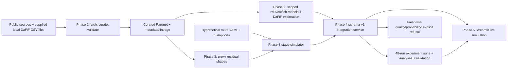

# Complete technical account: Indian fisheries cold-chain digital twin

**Evidence snapshot: 28 October 2026.** This document describes the system actually built and the experiments actually run. It is intended to be sufficient on its own for a technically honest presentation. The original `README.md` contains older proposal sections, including a planned Gradient Boosting classifier and a planned layout; those sections are **not** evidence that those capabilities were delivered.

## 1. What exists, in one page

The project is an auditable research prototype for **hypothetical chilled-finfish thermal exposure** on Indian export routes. It acquires and curates public datasets, fits a few narrowly scoped study models, simulates stage-by-stage air temperature, compares disruption scenarios, exposes a versioned Python service, and presents the thermal results in a local Streamlit dashboard. Its central numerical result is **degree-hours above a chosen comparison temperature**, not a fish-spoilage prediction.

| Component | Delivered result | Evidence level |
|---|---|---|
| Data pipeline | Reproducible source acquisition, curation, lineage, quality reports and Parquet tables | Verified against acquired source files; biological linkage gaps remain |
| Rainbow-trout TVC | Age-only linear estimate for one nominal 4 °C study | Internal grouped evaluation on 17 development assays; no untouched final or external test |
| Smoked-catfish outcomes | Categorical package × condition × day interpolation for seven measured endpoints | Within-study cell checks; no independent processing-run or dynamic-temperature validation |
| DaFiF gas sensors | Workbook-level unsupervised clustering | Descriptive sensor patterns, **not** freshness classes |
| Thermal twin | Configured air and conditional sea routes, disruptions, air and assumed product-lag traces | Engineering-verified **simulation**; route and physics inputs assumed |
| Integration and dashboard | Schema-v1 Python API, saved experiments, two-tab local UI and downloads | Software-tested; biological prediction explicitly unavailable |
| Fresh-finfish spoilage probability, shelf life, regulatory compliance, field reliability | **Not delivered** | Required paired temperature–quality and independent shipment data unavailable |

The most important presentation sentence is: **“We built and verified a reproducible cold-chain thermal-exposure simulator; the available data do not calibrate or validate a fresh-fish spoilage predictor.”** A simulated exposure difference can be called a *modeled thermal-exposure difference*. It cannot be called a measured change in freshness, food-safety risk or remaining shelf life.

### Evidence vocabulary

* **Observed** means a value directly present in a cited source file, with its actual sampling unit.
* **Internally evaluated** means a model was checked on held-out groups within the same study. It does not imply generalization to other species, exporters or routes.
* **Assumed/simulated** means a configured route, event, thermal response or transformed proxy pattern was used to calculate an indicator. It is not a measured Indian seafood journey.
* **Blocked/not calibrated** means the needed empirical target or linkage does not exist in the acquired data. An unavailable metric is not a metric of zero.

## 2. Architecture and flow



`src/data_pipeline/` handles source ingestion and reporting. `src/models/` holds the scoped model CLI and inference contracts. `src/digital_twin/` handles route definitions, first-order thermal simulation, exposure calculation, proxy replay and analysis. `src/integration/` is the stable service and batch experiment layer. `app.py` and `src/dashboard/` provide the UI, schema-checked saved-result loader and downloads. `run_project.py` orchestrates the full build.

The main data products are in `data/curated/`; saved models are in `models/`; route inputs are `configs/digital_twin/experiment.yaml` and `sea_route.yaml`; experimental tables are in `results/digital_twin/` and `results/integration/`; evidence reports and figures are in `reports/` and `figures/`. The source manifest, checksums, registry, field dictionary and column lineage live in `metadata/`. These are **separate source domains**; an identical day or species name does not create a specimen-level join.

## 3. Phase 1 — how the datasets were acquired and curated

The acquisition pipeline downloads versioned public sources where accessible, retains raw-source hashes, converts selected tabular members to typed Parquet, writes sample CSVs, checks source-level counts and provenance, and generates the dictionary, lineage and quality reports. The project also uses supplied local `combined_dataset.csv` and `Data_IIT2023150/Data/Dataset/`; a fresh checkout must contain them. Raw and curated folders are ignored by Git. Public links and rights are recorded in `metadata/dataset_registry.csv` and `metadata/source_manifest.json`; CC BY records require attribution, and MPEDA/other official material should not be redistributed without checking its terms.

| Curated table or source | Actual rows and sampling unit | What it can support | Critical limit |
|---|---:|---|---|
| DaFiF `fish_sensor_observations` | **27,120 sensor readings**, 63 official workbooks; Mackerel 9,020, Tilapia 9,029, Tuna 9,071 | Gas-pattern exploration | Repeated readings, unknown fish IDs; no linked measured target or product temperature |
| DaFiF `freshness_observed_labels` | **774 individual sensory criterion scores** across 129 species/day/session assessment groups | Separate descriptive sensory reference | Assessed fish differ from sensor fish; criterion rows are not 774 independent fish |
| Rainbow-trout sensors | **25,200 readings**, 210 sessions/CSVs, 59 longitudinal fillets | Sensor-pattern exploration | Repeated readings; embedded daily TVC/class fields are group-level proxies |
| Trout microbiology | **21 individual TVC assays**, three each on seven days, nominal 4 °C | Narrow day-to-TVC study model | Destructively assayed fillets differ from sensor-monitored fillets; no matched sensor labels or temperature variation |
| Trout modality availability | **413 rows** recording available modalities | Audit of what could be linked | Availability does not create an assay-to-sensor match |
| Smoked catfish | **336 measured long-format outcome rows**: 48 per each of seven endpoints | Within-study package/condition/day description | Smoked product, not fresh finfish; processing-run IDs and logger trajectories missing |
| MPEDA export statistics | **10,788** financial-year × dimension × measure rows | Indian trade context | Item, market and port are separate marginals, not joint shipment records |
| Citrus reefer proxy | **31,140** position/temperature rows | Nonfish thermal-shape sensitivity | Citrus packaging experiment, not fish or Indian export telemetry |
| Generic cold-room proxy | **1,411,515** sensor/time rows; **328,893** temperatures missing; 127 logged actions separately | Nonfish thermal-shape sensitivity | Unknown sensor placement/timezone, extensive gaps; no fish quality |
| Regulatory and route references | Two regulatory rows, seven route-stage catalog rows, two thermal-evidence rows | Documentation/configuration context | No outcome observations |
| Independent Indian seafood shipments with paired logger and measured quality | **0** | No field validation possible | The original shipment-prediction objective remains blocked |

### Reconciliation and cleaning decisions

The DaFiF article reports **9,041 per category (27,123 total)**; the official downloaded workbooks contain **27,120** readings, a three-row *net* difference with much larger category-level redistribution. The [Mendeley landing page](https://data.mendeley.com/datasets/vx4ptwk3pb/1) currently describes **9,401** sensor data per category, a further conflicting published figure. This project uses the **counted 63 workbooks** as its reproducible row basis. No balancing rows were invented. The source's common-name category labels are preserved; they should not be turned into precise taxonomic or Indian market claims.

The supplied `combined_dataset.csv` has **14,500 rows in 33 recording groups**. All 14,500 source-file-hash/row/sensor tuples match the official source; there are no raw sensor mismatches or exact duplicates. Its local session field disagrees with the official repository folder on **2,298 rows**: 1,878 Day-1 records and 420 rows from a Tongkol workbook whose filename says Session 2 but whose official folder says Session 1. The curated session follows the official folder, flags the filename conflict and preserves the original records. This is a documented source-metadata choice, not a silent label overwrite. The local file has 33 nulls each in four derived delta/rolling fields. Its full-session z-scores and progress use future observations, so they were excluded from the curated feature table; rolling/delta features were recomputed using only present/past workbook readings. The first delta and sample rolling standard deviation in each of 63 workbooks are expected nulls.

DaFiF gas readings use MQ135 and TGS2602 channels; measured units and calibration metadata are unavailable, and source-local timestamps have unknown timezone. A DaFiF sensory score of **0** conflicts with the described **1–9** scale and remains flagged. Trout sensor-chamber readings span **3.94–13.81 °C**, but chamber measurement temperature is not the nominal 4 °C storage treatment or fish-core temperature. Smoked-catfish conditions are **refrigerated 4–5 °C** and **ambient 25–30 °C** treatment ranges, not per-package temperature histories. The 84 catfish day-zero rows are shared baseline observations and are excluded from package/condition inferential checks. Generic cold-room missing temperatures remain null; source anomalies are not silently interpreted as seafood events.

**Join rule:** measured outcome, sensor trace and temperature trajectory can form a supervised example only with verified specimen/lot/batch and time relationships. Matching on species, day, session or filename resemblance alone would create ecological labels and leakage. Repeated readings within a fillet/workbook/shipment do not increase the number of independent biological or field samples.

The public origins are the [DaFiF data](https://data.mendeley.com/datasets/vx4ptwk3pb/1) and [associated article](https://pmc.ncbi.nlm.nih.gov/articles/PMC11528684/), [trout v4 record](https://zenodo.org/records/23600663), [smoked-catfish record](https://data.mendeley.com/datasets/tvsw53j89z/1), [MPEDA export portal](https://mpeda.gov.in/?page_id=438), [citrus reefer experiment](https://data.mendeley.com/datasets/mvr7m6mcgp/2) and [cold-room record](https://zenodo.org/records/15130001). This project extracted selected tabular data; it did not model trout images or establish fish-core telemetry from any of these sources.

## 4. Phase 2 — what was modeled and what was refused

### 4.1 Rainbow-trout total viable count (TVC)

The only predictive input is **storage age in days**. The target is individually measured **log10 CFU/g TVC** from a single rainbow-trout study at nominal **4 °C**. The output is an expected microbial-count estimate within days **0–6**, not freshness class, safety, shelf life, spoilage probability or response to a changed temperature history. The saved estimator is a linear regression in `models/freshness/trout_tvc.joblib`.

The development set contains **17 assays in six day cohorts** from **14 candidate original fish**. Candidate original-fish IDs were inferred from filenames and need author confirmation. Leave-one-day-out cross-validation withheld whole day cohorts and embargoed training assays sharing a candidate fish ID with the held-out cohort. Five bounded candidates were compared, choosing the simplest within 0.05 log units of the best grouped-CV MAE. The selected linear model had **MAE 0.5387**, **RMSE 0.7268**, **bias +0.0251** log10 CFU/g. The development-mean baseline MAE was **0.972**. A 10,000-resample **day-group** bootstrap gave a 95% percentile interval **0.233–0.936** for linear CV MAE; the paired baseline improvement interval **−0.267 to +1.151** crosses zero. This is a small-study internal check, not a new-study confidence interval.

An initial day-6 check was inspected **before** discovery that candidate original fish 18 appeared in both development day 5 and day 6. The development assay was embargoed and grouped CV rerun, but the final set is no longer untouched. The corrected **three-assay day-6 post-hoc diagnostic** gave MAE **0.283**, RMSE **0.301**, bias **−0.283**; all predictions were **7.574** versus observations **7.881, 7.968, 7.724** log10 CFU/g. These numbers must never be described as a pristine external test. There is no independent study validation. The model tends to overpredict day 4 and underpredict day 5 in grouped CV.

A second bounded experiment tested Theil–Sen, Huber, ridge, isotonic and spline alternatives using the same day/fish embargo. Theil–Sen improved nominal grouped-CV MAE to **0.501** and RMSE to **0.650**, versus linear **0.539/0.727**, but the paired six-day bootstrap improvement interval **−0.066 to +0.234** crosses zero. Forward-only day 2–5 mean MAE was **0.722** for Theil–Sen versus **0.786** linear; its advantage also lacked stable evidence. The saved linear model was **not replaced**. More model complexity cannot establish temperature dependence from a single nominal storage condition.

### 4.2 Smoked-catfish endpoints

The measured outcomes are **water activity, peroxide value, pH, mesophilic bacteria, coliform count, yeast count and mould count**. The project keeps three package types (paper, LDPE and vacuum PA/PE), two categorical conditions (ambient/refrigerated) and days **0/30/60/90** separate. Across each endpoint, 36 post-baseline rows cover six package × condition arms with two replicates at each post-baseline day; day-zero rows are shared baseline. Saved JSON artifacts contain treatment-cell means and **piecewise linear interpolation** within the observed day range. This is not fitted variable-temperature kinetics or a fresh-fish model.

Holding out day 60 within each of six arms and interpolating between available anchors gave peroxide MAE **2.595**, RMSE **4.688** source units; a day-30 carry-forward comparator MAE was **3.545**. Other endpoint day-60 interpolation MAEs were: coliform **1,146.917**, mesophilic bacteria **1,791.792**, mould **47.417**, water activity **0.001917**, yeast **208.750**, pH **0.055**, each in its own source units and **not comparable across endpoints**. The coliform carry-forward baseline was better (**883.583**). Processing-run independence is unknown, so six arms are not six verified independent batches.

An exploratory shape-preserving cubic (PCHIP) peroxide interpolation improved six-cell MAE to **1.124**, but won only three arms, and its paired bootstrap improvement interval **−0.076 to +4.195** crossed zero. It was worse for several other endpoints. A forward day-90 peroxide quadratic had MAE **3.863**, but missed one LDPE-ambient arm by **13.525** units. Neither challenger was promoted. The saved `models/thermal/smoked_catfish_endpoints.json` and peroxide convenience JSON retain simple bounded interpolation.

### 4.3 DaFiF sensor exploration and blocked prediction tasks

The **27,120** repeated sensor readings were summarized into **63 workbook-level** vectors using median and interquartile range of the two channels. Standardization, PCA and k-means were applied to the workbooks. Among **k = 2–5**, k = 3 had the highest silhouette **0.305**. PCA components 1 and 2 explain **45.4%** and **29.0%** of standardized feature variation. Cluster/species adjusted Rand index was **−0.024**. These are **descriptive sensor clusters**, neither freshness states nor independent-fish validation. Artifact: `models/exploration/dafif_workbooks.joblib`.

No specimen-matched DaFiF sensory label or trout sensor–TVC label exists. Therefore no defensible supervised sensor-freshness classifier, Gradient Boosting accuracy/F1/AUC, probability calibration or confusion matrix was produced. No fresh-finfish variable-temperature quality dataset was available to estimate species-specific thermal deterioration coefficients. `predict_quality_trajectory` and Phase 4 fresh-fish trajectory/probability targets explicitly raise `UnsupportedCalibrationError`; missing coefficients were not fabricated. The DaFiF, trout and smoked-catfish branches must not be merged into a fictitious shared biological training table.

## 5. Phase 3 — thermal-exposure digital twin

### Model and assumptions

The simulator walks a configured route stage by stage at **15-minute** default resolution, carrying temperature state across boundaries. Simulated air approaches the stage target by a first-order response, `T_air(t+Δt) = T_target + [T_air(t)−T_target] exp(−Δt/τ_air)`, with illustrative nominal **τ_air = 0.75 h**. Door opening uses a faster assumed air response `min(τ_air, 0.2 h)`; refrigeration-off and setpoint-offset events modify the target while active. A second channel responds to simulated air with an illustrative **τ_product = 1.5 h**. That channel is **estimated product lag**, never measured fish core. Species is request metadata and does not change the thermal equations. Overlapping thermal events are rejected explicitly.

For a selected comparison reference `R`, the indicator is **degree-hours** `∫ max(T(t)−R, 0) dt` in **°C·h**. The project reports both total and per-route-hour exposure, hours above reference, maximum continuous excursion, stage contributions and peak/mean temperatures. **2 °C and 4 °C are configurable comparison references, not universal legal limits, biological thresholds or spoilage rates.** A degree-hour total does not encode microbial growth without validated fish-specific kinetics and initial state.

The air route is a **hypothetical 47-hour Kochi-to-EU example**: landing/icing 3 h at 1.5 °C; processing 5 h at 3 °C; cold storage 12 h at 1 °C; road 5 h at 2 °C; airport 6 h at 3 °C; flight 12 h at 2 °C; destination 4 h at 3.5 °C. The conditional sea stress configuration is **375 h** baseline, including a **336 h (14-day) vessel stage** at 1.5 °C, a 10 h seaport stage and the other assumed stages. Neither route is an observed shipment. MPEDA FY2025–26 has **13,056.73922 tonnes chilled items across markets**, **297,517.86592 tonnes all products to the EU**, and **460.42683 tonnes all items via Cochin Air Cargo ACC**; these are **separate marginals**, not a chilled-finfish × Kochi × EU record. MPEDA's Cochin SEZ category does not establish the assumed sea voyage or its biological viability.

The eight air scenarios are baseline; processing delay +3 h; storage setpoint +3 °C; road refrigeration off for 2 h; airport +3 h with a 0.75 h door opening; flight +5 °C setpoint offset for 4 h; destination +3 h; and the combined road/airport/flight case. The sea scenario renames airport/flight to seaport/vessel and uses an 8 h vessel offset. All event magnitudes and route times are configured assumptions, not measured failure frequencies.

Two optional source modes replay **detrended, centered residual shapes** from a citrus reefer position stream or a selected generic cold-room sensor window on top of synthetic route setpoints. They do not substitute real fish, container-air or shipment logger traces. The citrus source selected `10C_OP.csv:P1_mean` at half-hour spacing; the cold-room replay selected a stable SENSOR02 window after a 120 h exclusion, with source anomalies/gaps documented. Source time is relative, not shipment time.

### Executed Phase 3/4 thermal results

The following numbers are for **synthetic simulated air above 2 °C** under the named configurations. Deltas compare the same route's baseline. Different-duration cases include exposure from added hours.

| Air scenario | Duration h | Total °C·h | Added °C·h vs 47 h baseline |
|---|---:|---:|---:|
| Baseline | 47 | **15.0455** | 0 |
| Processing delay | 50 | 18.0448 | 2.9993 |
| Storage +3 °C | 47 | 39.5658 | 24.5202 |
| Road refrigeration off | 47 | **70.8480** | **55.8025** |
| Airport delay and door | 50 | 52.3458 | 37.3003 |
| Flight excursion | 47 | 35.0454 | 19.9999 |
| Destination delay | 50 | 19.5401 | 4.4946 |
| Combined road/airport/flight | 50 | **128.0829** | **113.0374** |

For the air baseline, the assumed product-lag channel is **11.8803 °C·h**; for the combined case it is **124.3761 °C·h**. The 375 h sea baseline is **13.4640 °C·h** and the 378 h combined case **140.3982 °C·h**, an added **126.9342 °C·h**; the vessel-only excursion adds **34.7802 °C·h**. The long sea interval is configured below the 2 °C reference, explaining its low baseline despite its length. This **does not** show sea transport is safer, feasible for 14 days, or superior for fish quality. Air baseline per-route-hour exposure is **0.3201 °C**, combined **2.5617 °C**. The 15-to-5-minute discretization check differed by **0.0635%** for the air baseline, a numerical check only.

## 6. Phase 4 — integration, experiments and engineering validation

`from src.integration import execute` accepts an `IntegrationRequest` or schema-v1 dictionary and optional `include_trace`. It validates route (`air`/`sea`), scenario, temperature mode (`synthetic`, `proxy_citrus`, `proxy_coldroom`), UTC time, Celsius units, step, references and allowed perturbations. `target: thermal_exposure` returns a run ID, provenance, stage/event metrics, optional trace, **`status: SIMULATED_EXPOSURE_ONLY`**, **`prediction: null`** and capability **`NOT_CALIBRATED`**. The product-lag channel and proxy-shaped synthetic source are labeled explicitly. The service rejects unsupported fresh-fish quality-trajectory and spoilage-probability requests; it does not convert exposure into probability.

Separate targets expose only the original bounded study diagnostics: `trout_tvc_within_domain` (rainbow-trout fillet, nominal 4 °C, 0–6 days) and `smoked_catfish_endpoint_within_domain` (smoked catfish, known package/condition/endpoint, 0–90 days). Their model files are SHA-256 checked against the Phase 2 manifest before loading. They are **not coupled to the route temperature trajectory** and return `LIMITED_WITHIN_STUDY`, not a shipment spoilage forecast.

The executed experiment matrix is **2 routes × 3 temperature modes × 8 scenarios = 48 complete simulations**, with **192** route/mode/scenario/reference/channel comparison rows, **1,344** physical-stage rows and **48** saved trace Parquets. Analyses include exact three-intervention Shapley allocations, net interactions, standardized same-size stage perturbations, bounded low/central/high corner stresses and **2,400 paired scenario rows** from 200 air and 100 sea assumption draws across eight scenarios. The main batch output is `results/integration/scenario_comparison.parquet`; full traces and run provenance are mapped in `run_manifest.json`. The v1 API example is `results/integration/example_response.json`.

In the 2 °C synthetic air combined case, physical stage exposure is processing **3.9402**, cold storage **0.2362**, road **54.4322**, airport **43.8426**, flight **20.7435**, destination **4.8882**, landing/icing **0** °C·h; these sum to **128.0829**. Physical stage contribution says **where heat exposure occurs**, including carried-over temperature. Shapley says **how much of the combined increase is attributed to interventions across all intervention orders**: road **55.7699**, airport **37.2676**, flight **19.9999** °C·h, summing to **113.0374**. The sea road/seaport/vessel Shapley split is **55.7699 / 36.3841 / 34.7802** °C·h. These are two different decompositions and should not be presented as interchangeable.

The nominal road event is the largest single intervention under the configured air case. That is **conditional**, not a universal operational ranking: equal 2 h, +3 °C stage events make airport and flight each add **6.0000 °C·h** above 2 °C, while cold storage adds **2.9018**; the leading standardized stage changes with reference. In bounded assumption draws, road is the largest single intervention in **197/200 air draws at 2 °C**, **193/200 at 4 °C**, and **100/100 sea draws** for each reference. The **physical stage** with most combined-case exposure is road in only **137/200 air** and **75/100 sea** draws. The two notions of “largest” differ.

For combined **added** exposure, air assumption-draw median is **115.9022 °C·h**, with 5th/95th draw quantiles **83.8888/139.6812**; sea median **130.2725**, quantiles **91.8932/159.9828**. Low/central/high corner deltas are air **69.0180/113.0374/161.4560** and sea **77.9610/126.9342/185.8205** °C·h. Inputs varied within assumed bounds: stage durations ×0.85–1.15, setpoints ±0.5 °C, ambient ±3 °C, air response 0.4–1.2 h, product response 0.75–3 h and event duration ×0.75–1.25. These quantiles describe **uncertainty under chosen hypothetical input ranges**; they are **not** empirical confidence intervals, shipment-frequency estimates or biological prediction intervals. Nonfish proxy replay changes 2 °C baseline air to **15.4315** citrus/**15.8737** cold-room for air and **13.0315/14.2680** for sea.

Internal validation reloaded the 48 traces and checked stage-to-route conservation, finite nonnegative exposure, Shapley efficiency, trace round trips, reference values, zero-denominator behavior and refusal of uncalibrated biology. This is strong **software/analysis consistency** evidence, not measured thermal-system or fish-quality validation. The targeted public-data re-audit found no verified new specimen-linked fresh-fish multi-temperature dataset or independent Indian shipment outcome set.

## 7. Phase 5 — the dashboard users actually see

`app.py` is a **local Streamlit** interface with only **Simulation** and **Compare scenarios** tabs. The sidebar selects route, scenario, temperature source, comparison reference and channel, then runs the simulation. The live tab shows three compact values, a temperature trace, physical-stage exposure, matched-baseline comparison for a disruption and a ZIP download. The second tab reads schema-checked saved Phase 4 scenario deltas. Provenance and limitations are in a collapsed details panel. The UI does not display the research-only Shapley/Monte Carlo/model diagnostics by default. Changing a selection hides the previous live result until rerun.

The dashboard delegates calculations to `src.integration.execute`; it has no separate thermal model. The selected-run ZIP includes result JSON, trace, stages, events, summary, matched baseline and source provenance. A tested example is synthetic air road failure above 2 °C: **70.85 °C·h**, baseline **15.05 °C·h** after display rounding. The standing scope label explains that it is a simulation and fish spoilage is not calibrated. Browser QA exercised desktop, mobile at **390 px**, scenario changes, a proxy/product-lag selection and ZIP download; no page errors or horizontal overflow were observed. The app has **not** been publicly deployed.

## 8. Rebuild, environment and reproducibility

Use a copy of this project containing the supplied `combined_dataset.csv` and `Data_IIT2023150/Data/Dataset/`, **Python 3.12** and internet access for first-time public acquisition. From the repository root:

```powershell
py -3.12 run_project.py
```

On POSIX, use `python3.12 run_project.py`; on Windows without `py`, use `python run_project.py` only if that resolves to Python 3.12. The runner creates `.venv`, installs pinned `requirements.txt`, fetches/rechecks sources, builds/validates/reports curated data, trains bounded Phase 2 models, regenerates air/sea Phase 3 and all Phase 4 analyses, validates, runs tests and launches Streamlit at `http://localhost:8501`. Use `Ctrl+C` to stop it. `--no-dashboard` executes the build/tests and exits; `--offline` uses a complete copied raw-data folder; `--skip-install` reuses a prepared environment; `--dry-run` shows planned commands.

The latest complete **online-path orchestration** here was `run_project.py --skip-install --no-dashboard`: **13 stages passed in about 127 seconds**, with **41 tests passed**. It reused installed pinned packages and cached raw source bytes while exercising fetch/recheck. A complete offline orchestration and a separate pinned `pip install -r requirements.txt` also passed. **A brand-new empty machine with uncached public downloads has not been tested end to end**, and public-host availability can change. One optional Hammond/Dryad supplement returned HTTP 403; it is not an input to the thermal dashboard/model. Missing required inputs stop the runner rather than inventing records. `reports/setup/last_run.json` records the latest executed stages and timing.

The current pins include Python 3.12 compatibility, NumPy **2.5.4**, pandas **2.3.3**, scikit-learn **1.7.2**, SciPy **1.16.2**, PyArrow **21.0.0**, Streamlit **1.51.0** and Plotly **6.3.1**. An earlier Phase 2 report recorded pandas **3.1.0** at the time of that particular experiment; the later pinned environment uses pandas **2.3.3**, and the full one-command rebuild passed there. Configured seeds include modeling **47**, Phase 3 assumption draws **2403** and Phase 4 run suite **2404**. Source/model/config hashes and versions are recorded in manifests. This workspace has no Git repository, so there is no verifiable commit SHA.

For a quick verified API example after setup:

```python
from src.integration import execute

result = execute({"schema_version": 1, "target": "thermal_exposure",
                  "route": "air", "scenario": "road_failure",
                  "mode": "synthetic", "references_c": [2.0, 4.0]},
                 include_trace=False)
print(result["status"], result["prediction"])
print(result["thermal_exposure"]["route"]["air"]["references"]["2.0"]["degree_hours"])
```

The expected status is `SIMULATED_EXPOSURE_ONLY`, prediction is `None`, and that configured 2 °C result is approximately **70.8480 °C·h**. The dashboard can be launched separately with `.\.venv\Scripts\python.exe -m streamlit run app.py` on Windows or `.venv/bin/python -m streamlit run app.py` on POSIX. Test and build outputs are saved locally; neither successful tests nor the UI imply external fish validation.

## 9. Claims for a technically honest PPT

| Safe claim | Required qualification / claim to avoid |
|---|---|
| “We curated 27,120 DaFiF readings from 63 workbooks.” | Readings are repeated sensor measurements, not 27,120 independent fish; published counts conflict. |
| “We internally evaluated an age-only trout TVC regression.” | One nominal 4 °C study, 17 development assays; day-6 check post-hoc; no independent validation. |
| “We compared within-study smoked-catfish treatment curves.” | Smoked catfish cannot stand in for fresh-finfish kinetics; no changing-temperature validation. |
| “Three DaFiF sensor-pattern clusters were found.” | They are **not validated freshness classes**. |
| “The simulated 2 h road failure added 55.80 °C·h above 2 °C in the assumed 47 h air route.” | This is a conditional engineering calculation; **not 55.80% spoilage risk**. |
| “Road was the largest configured single disruption in most bounded assumption draws.” | Event magnitude/reference can reverse the ranking; draw ranges are assumed. |
| “The prototype regenerates data, models, scenarios, results and dashboard with one command.” | Cached-source orchestration passed; an entirely uncached fresh machine was not demonstrated. |
| “We can predict fresh-fish spoilage probability or remaining shelf life on Indian exports.” | **Do not claim this.** There are zero paired independent shipment outcomes and no calibrated fresh-fish variable-temperature quality model. |

Do not combine the three separate MPEDA item/market/port marginals into a specific Kochi-to-EU shipment, treat 2/4 °C references as blanket regulatory limits, label assumed product lag as fish-core measurements, or interpret a low sea degree-hour total as proof that a 14-day fresh-fish voyage is safe. Do not report classification accuracy, AUC, F1, Brier score, probability calibration, shelf-life error or field reliability: those tasks have no valid evaluation data. The project has **no experimentally validated end-to-end spoilage model**; its biological evidence is limited to internally evaluated single-study diagnostics.

Useful presentation figures already saved include `figures/integration/air_scenario_channels.png` (scenario indicators), `air_shapley.png` (conditional intervention attribution), `standardized_stage_events.png` (ranking dependence on event size), `assumption_draw_distributions.png` (assumption sensitivity), `physical_stage_rank_stability.png` and `figures/dashboard/redesign/` (actual interface). Captions should explicitly say **hypothetical thermal simulation** where applicable. A sound slide order is: research question and evidence boundary → source/grain/joins → supported Phase 2 tasks → thermal architecture/assumptions → executed scenario numbers → ranking/sensitivity → actual API/dashboard → data needed for biological validation.

## 10. What is needed to reach the original biological objective

First obtain controlled **fresh-finfish** experiments at multiple measured storage temperatures with species and product state, fish/lot/batch IDs, actual product-core or surface temperature histories, initial/follow-up microbial and sensory assays, methods/units/detection limits, and biological replicates. Preserve whole-batch/fish splits for modeling, then test on independent dynamic-temperature experiments. Separately collect **Indian exporter shipments** with stable anonymized shipment/lot/specimen/logger IDs, synchronized stage/event/air/product temperature series, packaging/ice status, and paired dispatch/arrival quality assays. Reserve whole later shipments, routes or exporters as a prespecified final test. Size the study by independent lots and outcome frequency, not by logger-row count. Only after such evidence should the service gain a versioned calibrated fish-quality adapter and report true external accuracy/calibration/uncertainty.

The concrete field schema is `configs/integration/field_linkage_schema.yaml`; `reports/data/blocked_data_requests.md` contains the acquisition protocol and **unsent** request drafts. No partners were contacted by this project. Frozen fish and shrimp are separate product branches needing their own empirical calibration; aggregate export statistics cannot supply it.

## 11. Audit trail and definitions

The primary local audit records are `reports/data/final_handoff.md`, `data_quality_report.md`, `scientific_sufficiency_report.md`, `metadata/data_dictionary.csv`, `metadata/column_lineage.csv`, `metadata/dataset_registry.csv`, `reports/modeling/PHASE_2_FINAL_RESULTS.md`, `reports/digital_twin/final_handoff.md`, `reports/integration/final_handoff.md`, `reports/dashboard/final_handoff.md`, and `reports/setup/final_handoff.md`. Machine-checkable metrics are in `reports/modeling/*.json`, `reports/integration/verification.json`, `results/integration/*.parquet` and the run/provenance manifests. The consolidated document above states the important facts so these links serve **audit and reproduction**, not as missing narrative.

**TVC** is total viable count, reported here as log10 colony-forming units per gram. **MAE/RMSE** are absolute/squared prediction error summaries in the target's units. **Degree-hours** are the time integral of temperature above a selected reference. **Shapley attribution** allocates a modeled combined effect by averaging intervention contributions over all orders; it is not causal field evidence. **Proxy-shaped synthetic** means a nonfish source supplies variation around assumed setpoints, not an observed seafood temperature. **Calibration** in this document means empirical linking of temperature/sensors to a measured fish-quality or outcome target; software consistency checks alone do not provide it.
