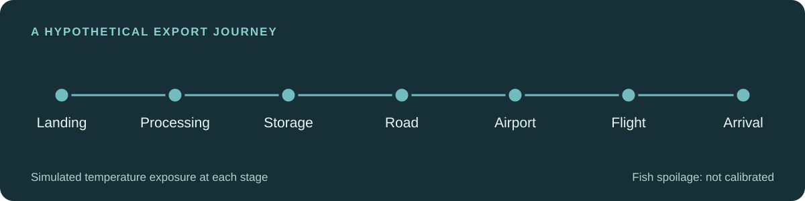
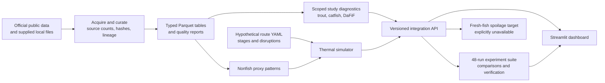

# Fisheries export cold-chain digital twin

**A reproducible research prototype for comparing simulated temperature exposure along a hypothetical chilled-fish export journey.** The simulator works; fresh-fish spoilage prediction is **not calibrated**.

[Explore the visual project guide](https://tchawla827.github.io/entre-project/) · [Read the complete technical account](COMPLETE_README.MD) · [View the presentation](Fisheries_Cold_Chain_Project.pdf)



## The question and the answerable result

Fish passes through landing, packing, storage, road handling, export transit and arrival. Cooling interruptions or delays can raise temperature during those stages. This project asks **where a specified disruption adds the most thermal exposure** in a configured journey.

For the hypothetical 47-hour air route, a two-hour road refrigeration failure increased simulated air exposure above a **2 °C comparison reference** from **15.05 to 70.85 °C·h**: an additional **55.80 °C·h**. It was the largest *single configured intervention* in this scenario set. This is a conditional simulation result. It does not measure spoiled fish, safety, shelf life or a real shipment. The [interactive results explorer](https://tchawla827.github.io/entre-project/#results) lets readers change route, source mode, channel and reference across the saved experiment matrix.

| What is ready | What is still blocked |
|---|---|
| Curated data and lineage; bounded within-study models; air/sea route simulation; 48 saved experiment runs; a versioned Python API; a local Streamlit dashboard | Specimen-matched sensor freshness classification; fresh-finfish temperature–quality kinetics; calibrated spoilage probabilities; independent Indian shipment validation |

**Degree-hours** measure temperature above a selected reference over time. For example, 5 °C for two hours is 3 °C above a 2 °C reference, or **6 °C·h**. The 2 °C reference is a comparison setting, not a universal spoilage threshold.

## Architecture



`src/data_pipeline/` acquires, reconciles and validates the inputs. `src/models/` handles scoped study models and refuses unsupported biological targets. `src/digital_twin/` simulates stage temperature and computes exposure. `src/integration/` supplies a schema-v1 API, saved experiments and verification. `app.py` and `src/dashboard/` implement the local interface. The static site in `docs/` explores **saved** results; the Streamlit application runs new configurations locally. Both keep simulated air, assumed product lag and nonfish proxy shapes separately labeled.

## Data and provenance

| Source | Curated observations | Role and limit |
|---|---:|---|
| [DaFiF workbooks](https://data.mendeley.com/datasets/vx4ptwk3pb/1) | 27,120 gas readings from 63 workbooks | Descriptive gas exploration; fish identities and measured sensor-paired quality unavailable |
| DaFiF expert sensory table | 774 criterion scores in 129 groups | Separate assessed fish; cannot label the sensor rows |
| [Rainbow-trout study](https://zenodo.org/records/23600663) | 25,200 sensor readings plus 21 individual TVC assays | Assays were taken on different fillets; one nominal 4 °C storage condition |
| [Smoked-catfish experiment](https://data.mendeley.com/datasets/tvsw53j89z/1) | 336 measured endpoint rows | Within-study package/condition/day descriptions; not fresh fish |
| [MPEDA export statistics](https://mpeda.gov.in/?page_id=438) | 10,788 annual statistic rows | Indian trade context; item, market and port totals are separate marginals, not shipments |
| [Citrus reefer](https://data.mendeley.com/datasets/mvr7m6mcgp/2) and [cold-room data](https://zenodo.org/records/15130001) | 31,140 and 1,411,515 temperature rows | Nonfish proxy variation; not fish core or observed seafood journeys |

The DaFiF article states **27,123** sensor rows; the 63 downloadable workbooks contain **27,120**. The local combined CSV has **2,298** session-label disagreements with official folder metadata. We use verified workbook counts, preserve raw records, flag conflicts and avoid inventing reconciliation rows. Source-level decisions are in the [data quality report](reports/data/data_quality_report.md), [dictionary](metadata/data_dictionary.csv), [registry](metadata/dataset_registry.csv) and [lineage](metadata/column_lineage.csv). Repeated sensor readings are not independent fish. Sensor and quality tables are not joined without verified specimen relationships.

Raw downloads and regenerated curated tables are omitted from Git history. The supplied local DaFiF files required by the audit are present in `Data_IIT2023150/Data/Dataset/` and `combined_dataset.csv`; the rest are fetched by the runner. See [source and redistribution notes](COMPLETE_README.MD#3-phase-1--how-the-datasets-were-acquired-and-curated).

## Models and evaluation

| Task | Executed method | What the metric means |
|---|---|---|
| Trout TVC at nominal 4 °C | Age-only linear regression | Grouped leave-one-day-out CV on **17 development assays**: MAE **0.539 log10 CFU/g**; mean baseline **0.972**. No untouched final or external test. |
| Smoked-catfish endpoints | Package × condition × day piecewise interpolation | Peroxide held-out day-60 six-cell MAE **2.595** source units; within-study interpolation only. |
| DaFiF sensors | Workbook-level PCA + k-means | 63 workbook vectors; k=3 silhouette **0.305**. Clusters are sensor patterns, not freshness classes. |
| Fresh-finfish spoilage classification / thermal deterioration | **Blocked** | No valid paired specimen labels or multi-temperature quality observations. No classifier accuracy, calibrated probability or kinetics is reported. |

The trout day-6 check was inspected before a candidate original-fish overlap was discovered. After correcting the development set, its three-assay MAE of **0.283** remains a **post-hoc diagnostic**, never an untouched final test. A later Theil–Sen challenger had nominal grouped-CV MAE **0.501**, but its paired day-bootstrap advantage over linear crossed zero; the saved linear artifact was not replaced. Smoked-catfish cubic interpolation similarly showed an uncertain exploratory gain and was not promoted. Full protocols, diagnostics and figures are in the [Phase 2 consolidated report](reports/modeling/PHASE_2_FINAL_RESULTS.md).

## Scenario experiment and limits

The air example has seven assumed stages and a 47-hour baseline. A conditional sea stress case has a 375-hour baseline, including an assumed 14-day voyage. Both use first-order illustrative temperature responses and compare exposure above 2 °C and 4 °C. The sea case is a software/operations stress test; its low baseline degree-hours cannot establish biological viability. [Route configurations](configs/digital_twin/) identify all stage times, setpoints and events.

The executed matrix has **2 routes × 3 temperature modes × 8 scenarios = 48 runs**, yielding **192** route/mode/scenario/channel/reference comparisons and **1,344** physical-stage rows. Exact intervention attribution, standardized event sizes and bounded assumption sensitivity are saved separately. In **197 of 200** air-route assumption draws above 2 °C, road failure remained the largest configured single intervention. These are hypothetical input variations, **not 98.5% model accuracy or field validation**. Equal-size interventions or another comparison reference can change the ranking. See the [Phase 4 report](reports/integration/final_handoff.md) and [claim–evidence matrix](reports/integration/claim_evidence_matrix.md).

No independent Indian export shipment has paired fish temperature and measured quality outcomes in the available data. The API returns `SIMULATED_EXPOSURE_ONLY`, `prediction: null`, and `NOT_CALIBRATED` for thermal exposure; unsupported fresh-fish quality or probability requests raise `UnsupportedCalibrationError`.

## Run locally

Requirements: **Python 3.12**, internet access for first-time public-source acquisition, and this repository's included local DaFiF files. On Windows:

```powershell
py -3.12 run_project.py
```

On macOS/Linux, use `python3.12 run_project.py`. The command creates `.venv`, installs pinned dependencies, fetches public data, curates and validates it, trains the supported study models, runs the thermal and integrated experiments, verifies the results, runs tests and starts the dashboard at `http://localhost:8501`. Use `--no-dashboard` for a build/test run. With a complete copied `data/raw/`, use `--offline` to avoid downloads. A separate portable Windows distribution contains Python and cached data.

The most recent full **cached online-path** orchestration passed 13 stages and 41 tests; the portable offline copy passed 12 stages and 41 tests. An entirely uncached download on a new machine was not tested end to end; public-source availability may change. The code and local data required by `run_project.py` are in this repository, while the portable distribution avoids first-run downloads. `reports/setup/` contains setup evidence.

## Research next step

Collect fish/lot/logger/assay IDs, measured product temperatures across multiple conditions, initial and follow-up fish-quality endpoints, and independent Indian export journeys. Then fit species/product-specific deterioration models with biological-group splits and a prespecified shipment holdout. The [field linkage schema](configs/integration/field_linkage_schema.yaml) and [blocked-data protocol](reports/data/blocked_data_requests.md) specify the records needed. Until those records exist, this is an **engineering simulation and research platform**, not a validated spoilage predictor.

The [complete technical account](COMPLETE_README.MD) is the detailed source for every phase, source decision, metric, limitation and artifact.
