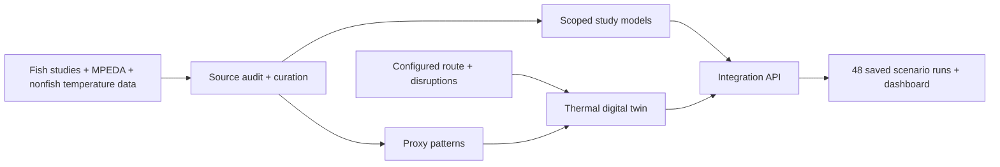

# Fisheries cold-chain digital twin

**Where does a simulated fish export journey pick up heat?**

[Explore the interactive results](https://tchawla827.github.io/entre-project/) · [Full technical account](COMPLETE_README.MD) · [Presentation](Fisheries_Cold_Chain_Project.pdf)


> **What it does:** compares thermal exposure across configured routes and disruptions. **What it cannot do yet:** predict actual fish spoilage.

## One result

| Configured 47-hour air route · simulated air · above 2 °C | Exposure |
|---|---:|
| Baseline | 15.05 °C·h |
| Two-hour road cooling failure | 70.85 °C·h |
| **Added by road failure** | **+55.80 °C·h** |

Road cooling failure was the largest **single configured disruption** in this scenario set. In 197 of 200 bounded changes to simulation assumptions, it remained largest. These are hypothetical tests, **not model accuracy or shipment validation**. Degree-hours compare temperature above a selected reference over time; the reference is not a spoilage threshold. [See all saved comparisons →](https://tchawla827.github.io/entre-project/#explore)

## System map



## Evidence at a glance

| Source | Measured records | Role |
|---|---:|---|
| [DaFiF](https://data.mendeley.com/datasets/vx4ptwk3pb/1) | 27,120 sensor readings in 63 workbooks | Gas-sensor exploration |
| [Rainbow trout](https://zenodo.org/records/23600663) | 25,200 sensor readings; 21 separate TVC assays | Limited within-study quality analysis |
| [Smoked catfish](https://data.mendeley.com/datasets/tvsw53j89z/1) | 336 endpoint rows | Smoked-product treatment curves only |
| [MPEDA](https://mpeda.gov.in/?page_id=438) | 10,788 aggregate statistics rows | Export context, not shipment records |
| [Citrus reefer](https://data.mendeley.com/datasets/mvr7m6mcgp/2) + [cold room](https://zenodo.org/records/15130001) | 31,140 + 1,411,515 temperature rows | Nonfish variation proxies |

The DaFiF paper says 27,123 rows; the 63 official workbooks contain 27,120. We preserved and documented 2,298 local session-label disagreements. Repeated sensor readings are not independent fish, and trout sensors and assays were collected from different fillets. [Data quality audit →](reports/data/data_quality_report.md)

## Model status

| Task | Result | Scope |
|---|---|---|
| Trout TVC, nominal 4 °C | Grouped CV MAE **0.539 log10 CFU/g** on 17 development assays | Age-only within-study model; no untouched external test |
| Smoked-catfish peroxide | Held-out day-60 MAE **2.595 source units** | Within-study interpolation |
| DaFiF gas patterns | k=3 silhouette **0.305** | Unsupervised patterns, not freshness classes |
| Fresh-fish spoilage probability | **Blocked** | No paired fish temperature and quality outcomes |

[Model evaluation →](reports/modeling/PHASE_2_FINAL_RESULTS.md) · [Scenario verification →](reports/integration/final_handoff.md) · [Claim–evidence matrix →](reports/integration/claim_evidence_matrix.md)

## Run

Python 3.12, then:

```powershell
py -3.12 run_project.py
```

The runner acquires public sources, curates data, executes supported models and simulations, verifies results, runs tests, and launches the local dashboard. Use `--no-dashboard` for a build-only run. The last cached-path run passed **13 stages and 41 tests**; an uncached first download on a new machine has not been tested end to end. [Setup details and all limitations →](COMPLETE_README.MD)
